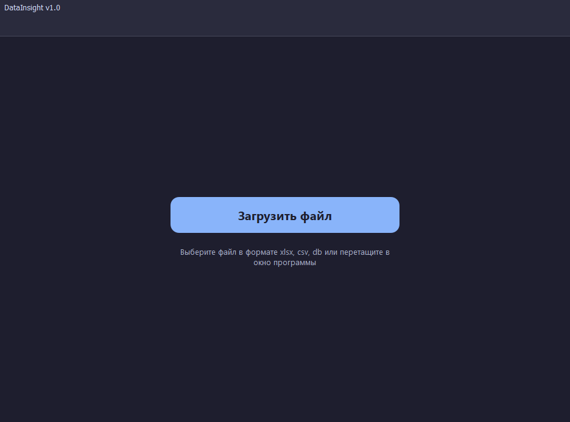
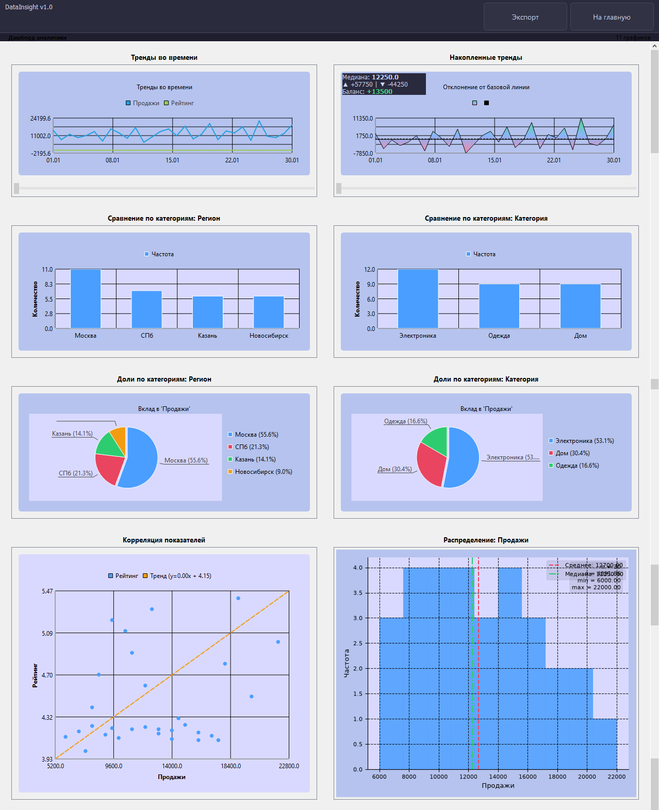

  <h1>📊 DataInsight Desktop</h1>
  
<b>Легковесное офлайн-приложение для автоматического анализа, визуализации табличных данных и генерации отчётов</b>

  
  <!-- Бейджи (можно оставить или удалить) -->
  
  
  
  

---

##  Актуальность проекта

*   **Рост объёмов данных:** Бизнес и наука генерируют всё больше табличных данных.
*   **Проблемы ручного анализа:** Работа в Excel трудоёмка и сопряжена с высоким риском ошибок.
*   **Недостатки коммерческих BI:** Power BI, Tableau и Qlik Sense — платные, требуют серверов, интернета и избыточны для локальных задач.

Есть потребность в лёгком, офлайн-инструменте с автоматическим профилированием, визуализацией и экспортом отчётов.

---

##  Простота использования

1. Запустите **portable `.exe`** файл 
2. Перетащите файл `.xlsx`, `.csv` или `.db` (SQLite) в окно приложения.
3. Получите готовый **Дашборд** с автоматически подобранными графиками.
4. Настройте временной график по оси Х через окно **Экспорт -> Предпросмотр**.
5. **Масштабирование:** Используйте интерактивное масштабирование (Zoom) по оси X для графиков *«Тренды во времени»* и *«Накопленные тренды»*.
6. **Экспорт:** Сохраните результаты в DOCX (с таблицами и графиками) или PNG.

###  Скриншоты интерфейса
<!-- Замените пути на свои названия файлов, когда добавите их в репозиторий -->

  
  
<i>Главное окно и зона загрузки</i>

  
  
  
<i>Сгенерированный дашборд с графиками</i>

  
  
<i>Панель экспорта и предпросмотра</i>

---

##  Гибкость — главное преимущество

Приложение работает с данными **любого контекста**: финансы, показания приборов, логистика, учёт, статистика. 
Система подстраивается под объём: от 10 строк до десятков тысяч. Каждая колонка анализируется отдельно. 

> *Например: Если в таблице несколько категориальных столбцов, система построит круговую диаграмму и гистограмму для каждого из них.*

### Поддерживаемые типы диаграмм

| № | Тип диаграммы | Что показывает | Пример использования |
|:-:|:--------------|:---------------|:---------------------|
| 1 | **Линейная** | Как меняется показатель со временем | Динамика продаж за год, температура по дням |
| 2 | **С областями** | Как накапливается объём со временем | Рост выручки, накопленные расходы за месяц |
| 3 | **Столбчатая** | Сравнение значений по категориям | Продажи по магазинам, результаты сотрудников |
| 4 | **Круговая** | Доли частей в целом | Структура расходов, доля рынка конкурентов |
| 5 | **Диаграмма рассеяния** | Есть ли связь между двумя показателями | Зависимость прибыли от расходов на рекламу |
| 6 | **Тепловая карта** | Какие показатели связаны между собой | Поиск взаимосвязей в большом наборе данных |
| 7 | **Гистограмма** | Как распределены значения | Большинство клиентов в определённом возрасте |
| 8 | **Ящик с усами** | Где норма, а где аномалии | Поиск отклонений в расходах, продажах |

---

##  Статистический профиль данных

При загрузке файла приложение автоматически рассчитывает базовую статистику по каждой колонке:

| Метрика | Описание |
|:--------|:---------|
| **Пропуски** | Количество пустых значений (NaN) — индикатор качества данных |
| **Уникальные** | Число различных значений — помогает определить тип колонки (категориальная / числовая) |
| **Среднее** | Арифметическое среднее (только для числовых колонок) |
| **Макс** | Максимальное значение в колонке |

**Как используются эти данные:**
*   Автоматический подбор подходящих типов графиков.
*   Предупреждение пользователя о проблемах в данных (много пропусков, константные колонки).
*   Формирование сводной таблицы в экспортируемом DOCX-отчёте.

*Расчёт выполняется модулем `StatisticCalculator` на этапе анализа, до построения визуализаций. Таблица доступна для экспорта в формате docx, выберите "Таблица статистики" в окне.*

---

##  Архитектура (Clean Architecture)

Проект строго следует принципам чистой архитектуры (Dependency Inversion Principle). Слои изолированы и не пересекаются:

*   **🧠 Domain:** Ядро системы. Сущности (`DatasetProfile`, `Chart`), объекты-значения (`ColumnType`, `ChartRule`), интерфейсы (`IDataLoader`, `IChartRenderer`).
*   **⚙️ Application:** Бизнес-логика и сценарии. Сервисы (`DataService`, `AnalysisService`, `ChartBuilderService`, `ReportService`), DTO.
*   **🔌 Infrastructure:** Реализация контрактов домена. Загрузчики (`ExcelLoader`, `CsvLoader`), детектор типов, калькулятор статистики, рендереры (QtCharts), экспортёры (DOCX, PNG).
*   **🖥 Presentation:** GUI. `MainWindow`, `DashboardContainer`, панели, темы оформления.

---

##  Технологический стек

*   **Язык и среда:** Python 3.13+, PyCharm IDE, Git
*   **GUI и визуализация:** PySide6 (Qt), QtCharts, Matplotlib
*   **Обработка данных:** Pandas, openpyxl
*   **Генерация документов:** python-docx
*   **Тестирование и сборка:** pytest, PyInstaller

---

##  Установка и запуск

### Для пользователей (Portable)
Просто скачайте `DataInsight.exe` из раздела **Releases** и запустите. Установка Python или дополнительных библиотек не требуется. Работает полностью офлайн.

